# tde-systemd

Graphical systemd administration for the [Trinity Desktop Environment](https://www.trinitydesktop.org/) (TDE R14.1).

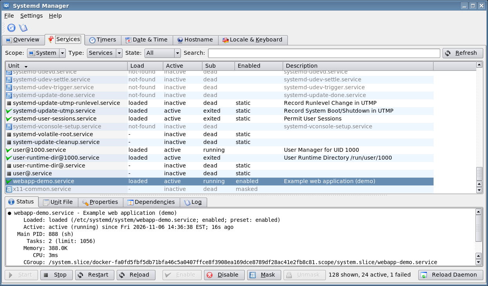

tde-systemd has two applications, each also available as a TDE Control Center module:

| Program | Control Center module | Purpose |
|---|---|---|
| **Systemd Manager** (`tde-systemd-manager`) | *System Administration → Systemd Services* (`tdecmshell tdesystemd`) | Services and units, timers, date & time, hostname, locale & keyboard |
| **Journal Viewer** (`tde-journal-viewer`) | *System Administration → System Journal* (`tdecmshell tdejournal`) | Read, filter, follow and export the journal; journal maintenance |

## Features

### Systemd Manager
- **Overview**: system state (running / degraded / …), host, OS, kernel, systemd version, startup time, failed units (system and user) and the slowest units at boot.
- **Services**: system **and** user units. You can filter by type (services, sockets, timers, targets, mounts, paths, slices) and by state (active, failed, enabled, masked, …), or search by name.
  - Start, stop, restart, reload, enable, disable, mask, unmask, reset failed, kill, daemon-reload.
  - The detail tabs show the status, the unit file with drop-ins, properties, dependencies and the unit's log.
- **Timers**: next and last run, time left and time passed. You can start, stop, enable or disable each timer.
- **Date & Time** (if `systemd-timedated` is available): NTP on/off, manual date and time, time zone, RTC in local time.
- **Hostname** (`systemd-hostnamed`): static and pretty hostname, icon, chassis, deployment and location, plus machine information.
- **Locale & Keyboard** (`systemd-localed`): `LANG` and the `LC_*` categories, console keymap, and X11 layout, model, variant and options.
- You can hide the optional pages in *Settings*. Pages whose systemd service isn't installed are hidden automatically.

### Journal Viewer
- Reads the **system** or **user** journal.
- Filters by boot, priority, unit, syslog identifier, since/until (`today`, `1 hour ago`, …), message regex and kernel only. You can also search instantly within the results.
- Messages are coloured by priority. The detail pane shows every journal field.
- **Follow** mode works like `journalctl -f`. You can export to text.
- *Read all as administrator* reads the complete journal for users who aren't in the `systemd-journal` group.
- **Maintenance**:
  - Shows disk usage.
  - Vacuums old entries by size, age or file count.
  - Rotate, flush, sync and verify.
  - Shows the active `journald.conf`.

### Security: polkit
The GUI never runs as root. System changes are carried out by the small helper
`tde-systemd-helper`, started through `pkexec`. The helper:

- accepts only a fixed set of operations;
- validates every argument (unit names, host names, time zones, sizes, journal filters);
- runs the systemd tool directly, without a shell.

Each category has its own polkit action, so administrators can tune them separately:

`org.trinitydesktop.tde-systemd.{units,journal,journal-read,hostname,timedate,locale}`

A polkit authentication agent must run in the session. Use `polkit-agent-tde`; the Debian package depends on it.

## Screenshots

| | |
|---|---|
| 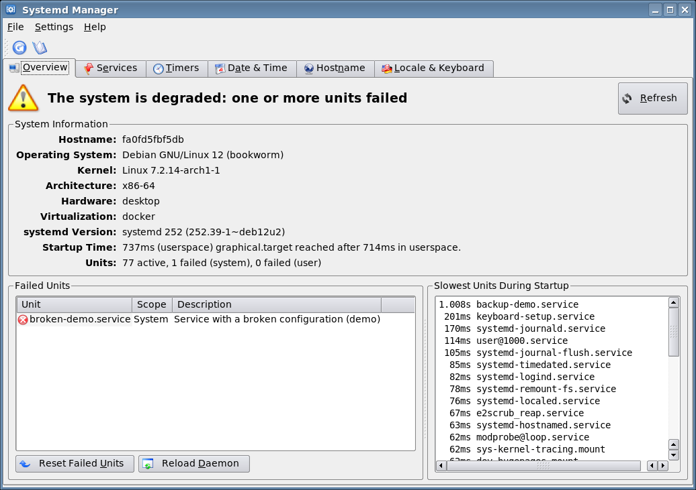 | 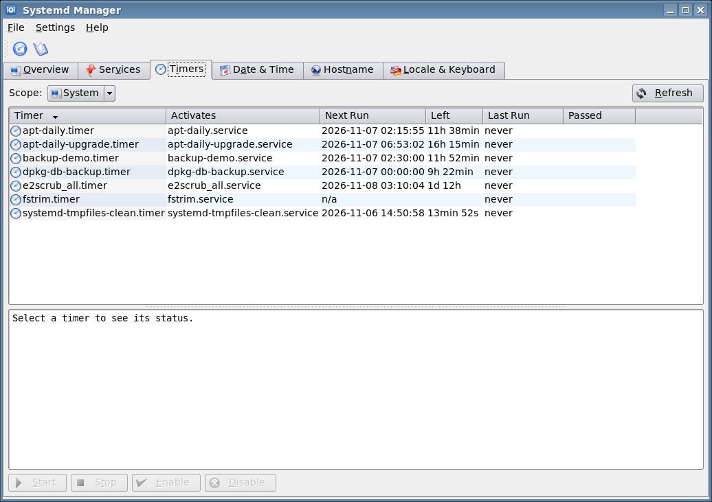 |
| 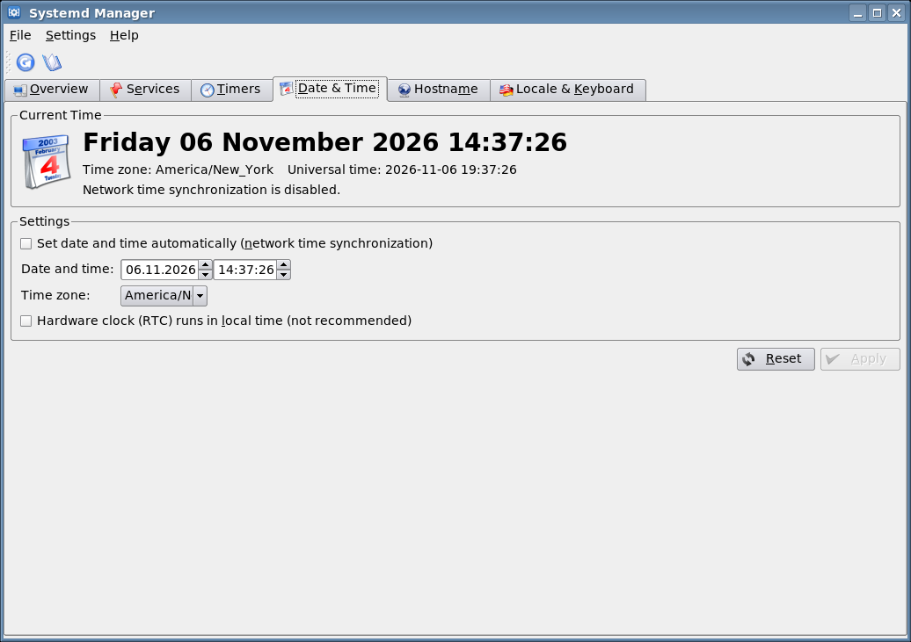 | 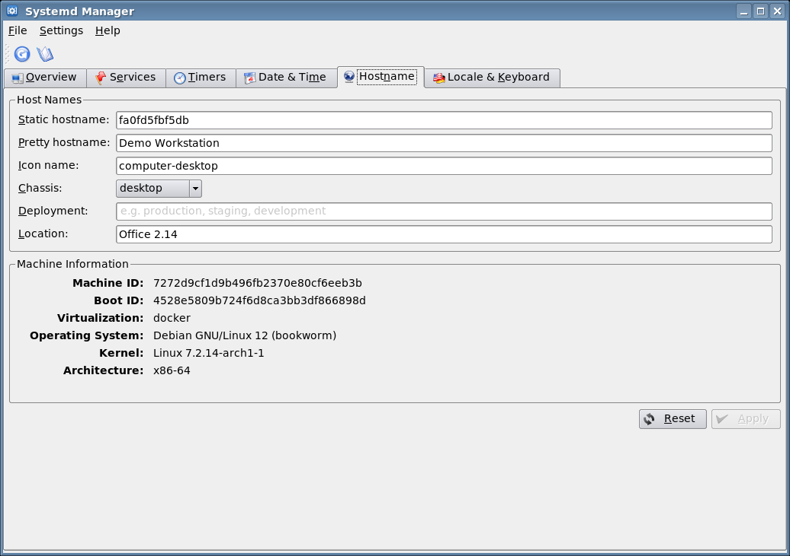 |
| 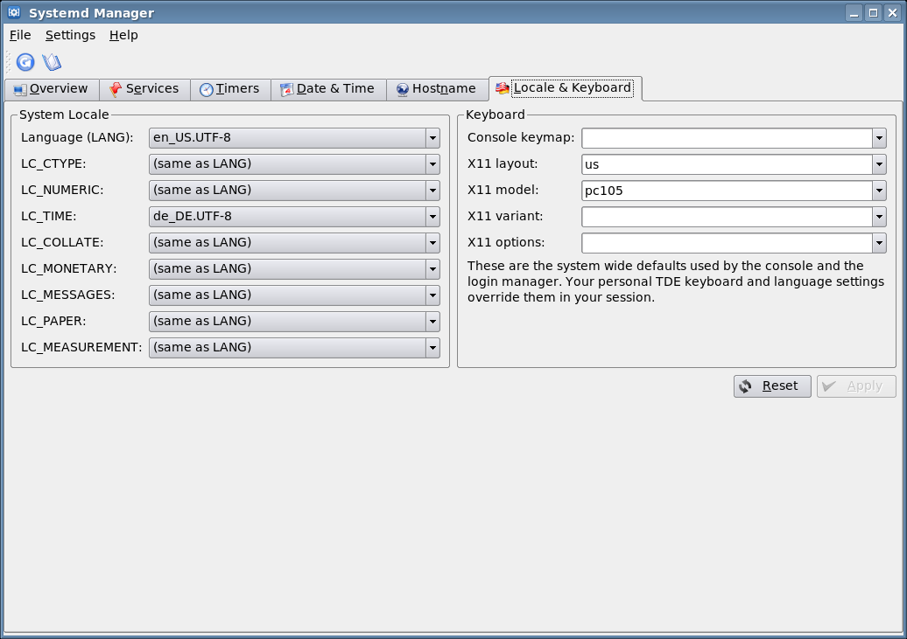 | 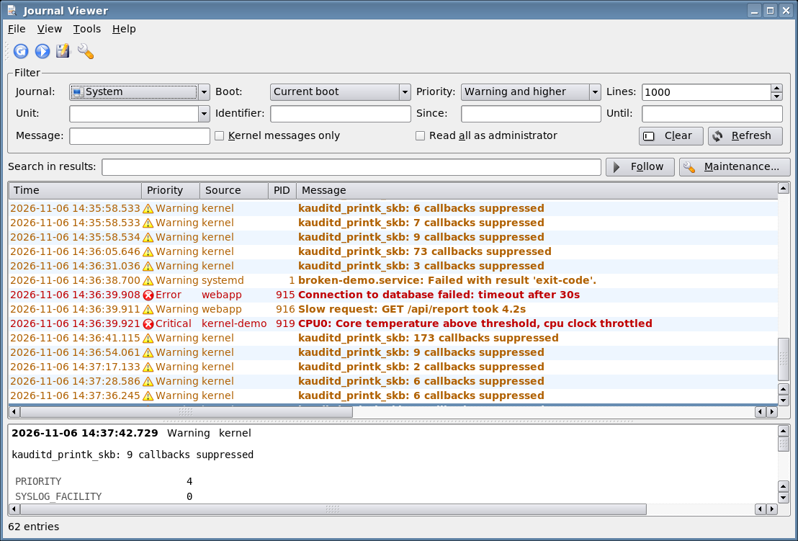 |
| 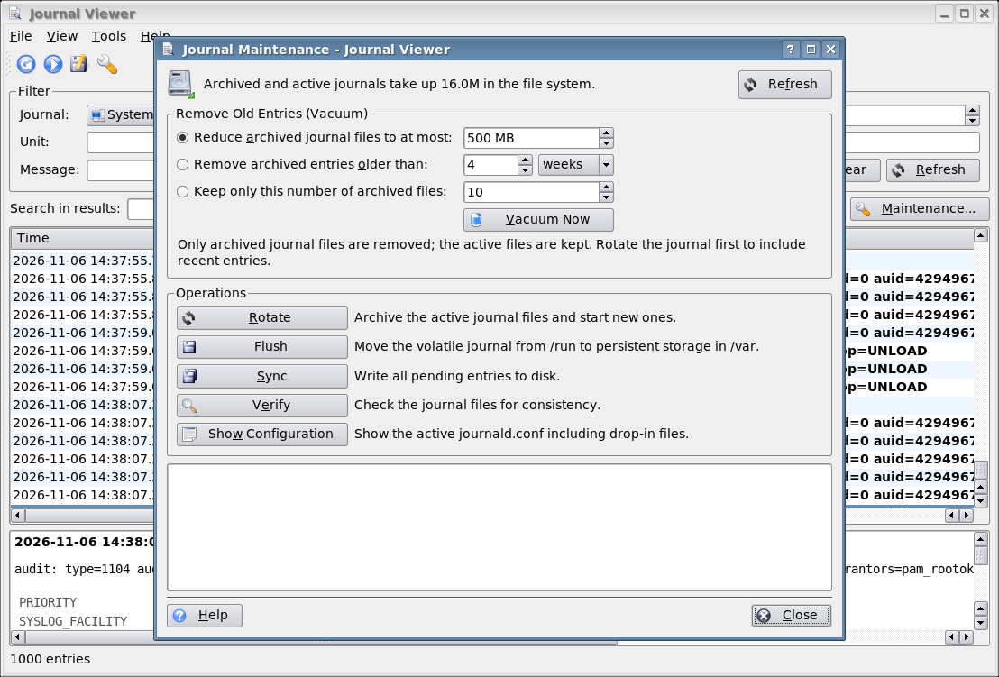 | 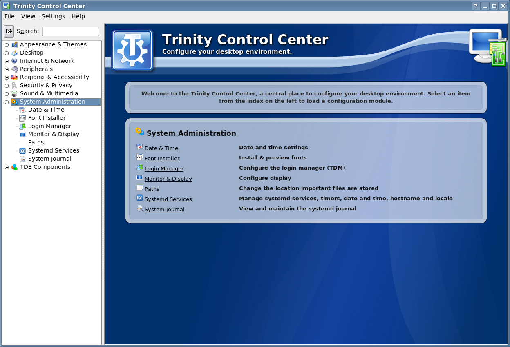 |
| 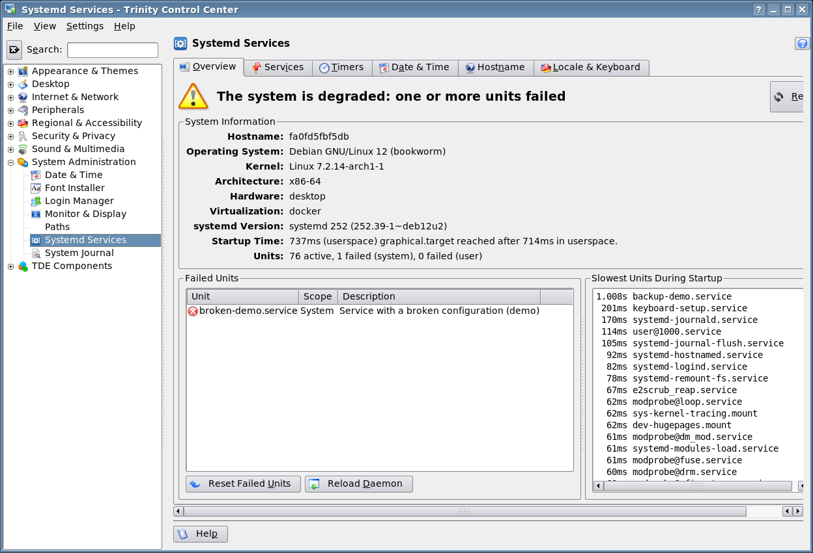 | 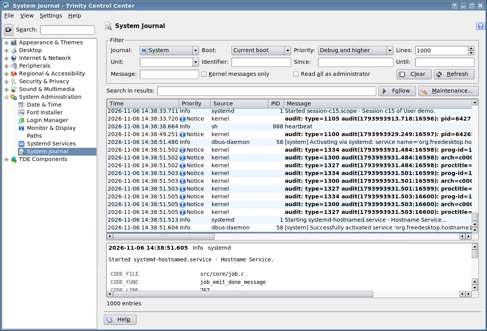 |
| 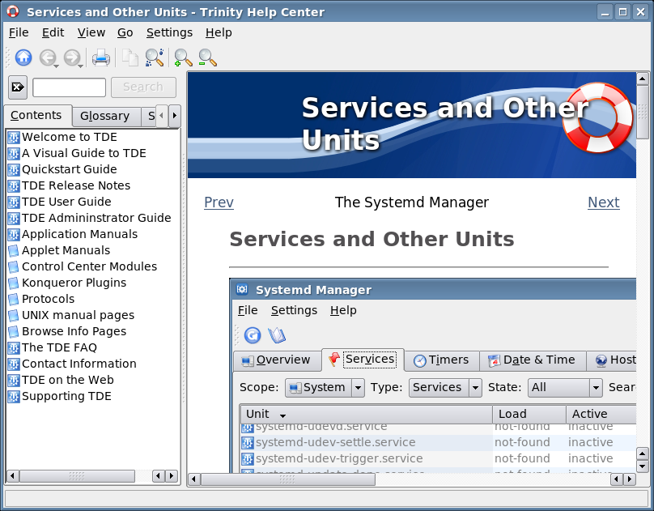 | |

The screenshots are created with `scripts/screenshots.sh`. It runs the applications in a systemd-booted Docker container under Xvfb.

## Installation

### Debian packages
GitHub Actions builds packages for **Debian 12 bookworm** and **Debian 13 trixie** on every push. Download them from the workflow artifacts, or from the release page for tagged versions. You need the [TDE R14.1 repository](https://wiki.trinitydesktop.org/Debian_Trinity_Repository_Installation_Instructions) configured, then run:

```sh
sudo apt install ./tde-systemd_1.0.0~bookworm_amd64.deb
```

To build the package yourself in a clean container:

```sh
docker run --rm -v "$PWD":/src -w /src debian:bookworm scripts/build-deb.sh bookworm dist
```

### From source
Requirements: `tde-cmake`, `tdelibs14-trinity-dev`, CMake.

```sh
cmake -S . -B build -DCMAKE_INSTALL_PREFIX=/opt/trinity
make -C build -j"$(nproc)"
sudo make -C build install
```

CMake options:

| Option | Default | |
|---|---|---|
| `BUILD_DOC` | `ON` | Handbook and man pages |
| `BUILD_KCM` | `ON` | Control Center modules |
| `POLKIT_ACTIONS_DIR` | `/usr/share/polkit-1/actions` | Where the polkit policy is installed |
| `HELPER_INSTALL_DIR` | `${LIBEXEC_INSTALL_DIR}` | Where `tde-systemd-helper` is installed |

## Documentation
- The handbook is in KHelpCenter: `khelpcenter help:/tde-systemd`. Its source is in `doc/en/index.docbook`.
- Man pages: `tde-systemd-manager(1)`, `tde-journal-viewer(1)` and `tde-systemd-helper(8)`, in `doc/man/`.

## Command line

```sh
tde-systemd-manager --page timers            # open a page
tde-systemd-manager --unit cups.service      # select a unit
tde-journal-viewer --unit ssh.service -f     # follow one unit
tde-journal-viewer -p 3 -b -1                # errors of the previous boot
tde-journal-viewer --maintenance             # open the maintenance dialog
```

## Source layout

```
src/common/    shared widgets: pages, journal widget, process runner, JSON parser
src/manager/   tde-systemd-manager main window
src/journal/   tde-journal-viewer main window
src/kcm/       Control Center modules (kcm_tdesystemd)
src/helper/    tde-systemd-helper and the polkit policy
data/          launchers and icons
doc/           handbook (en) and man pages
debian/        Debian packaging
scripts/       build-deb.sh, screenshots.sh
```

## License
The programs are licensed under the GNU GPL version 2 or later (see `COPYING`). The documentation is licensed under the GNU FDL 1.2 or later.
